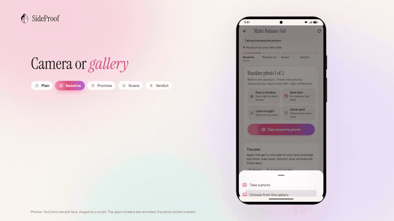
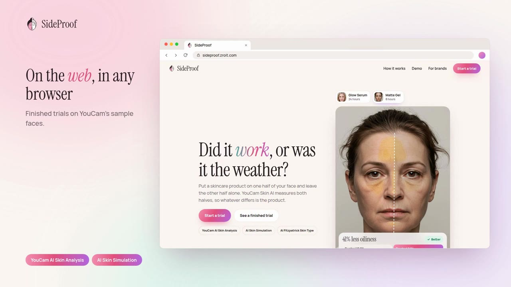
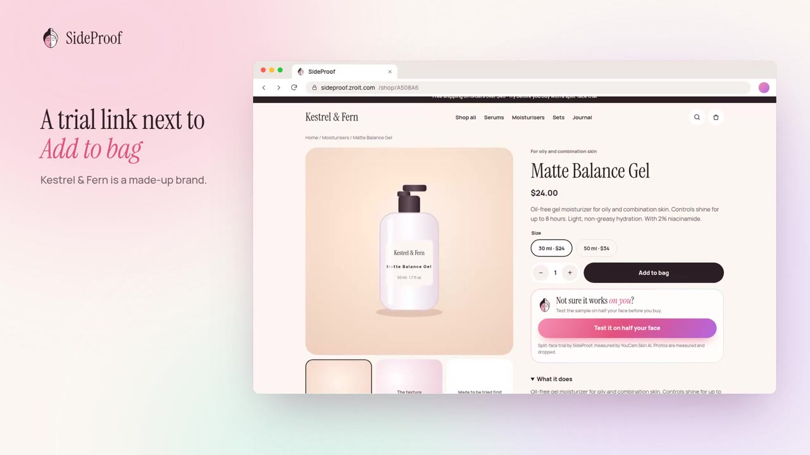
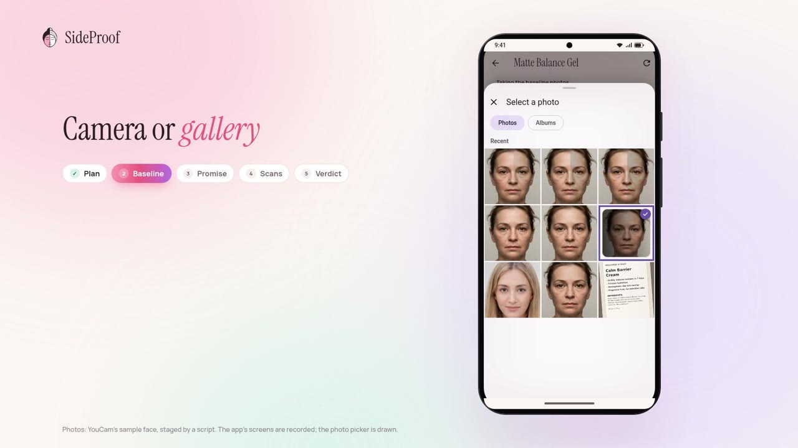
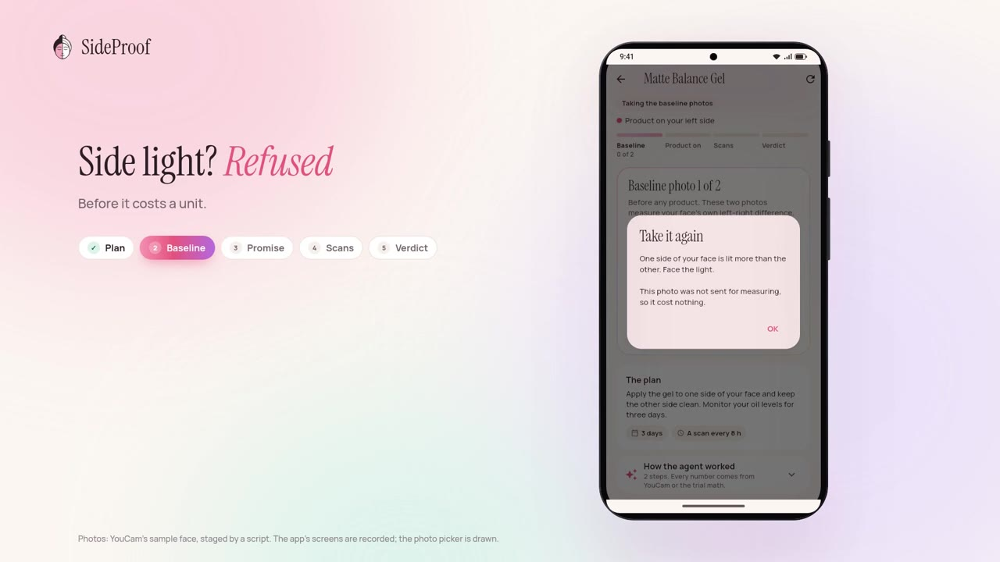
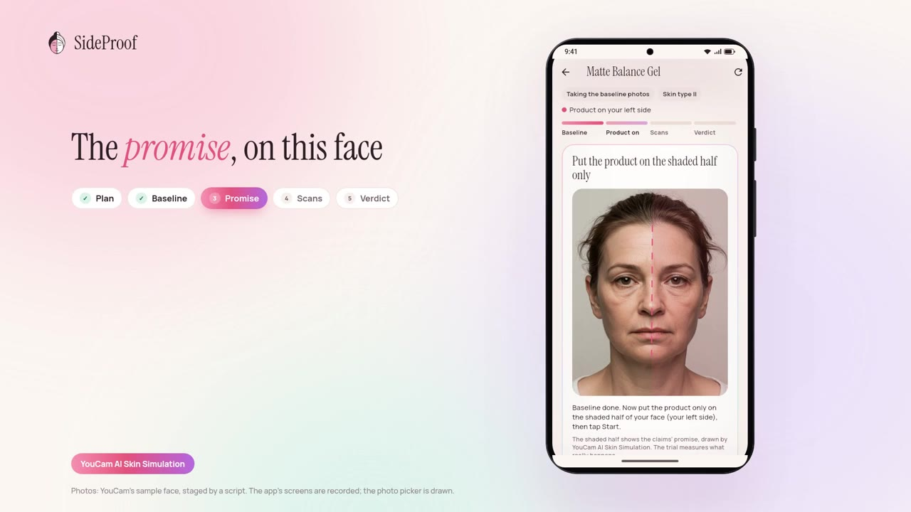
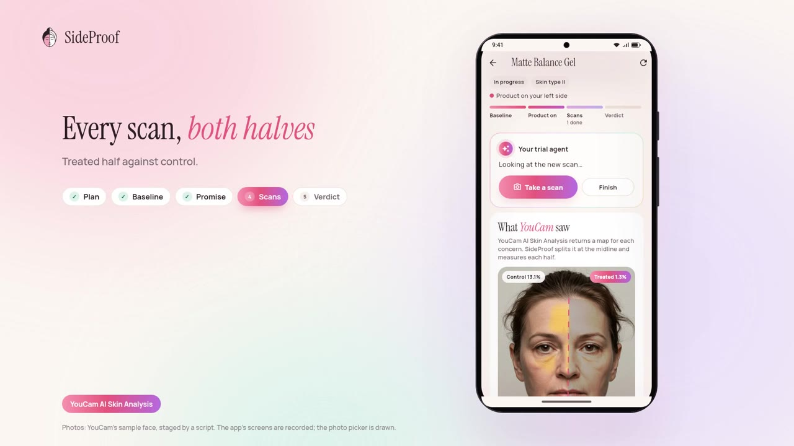
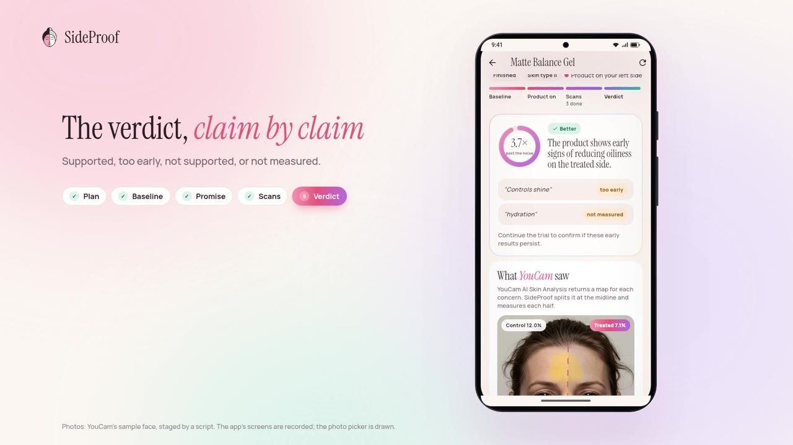
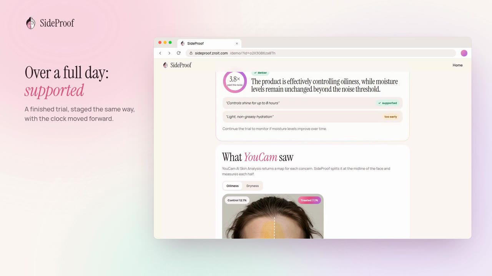
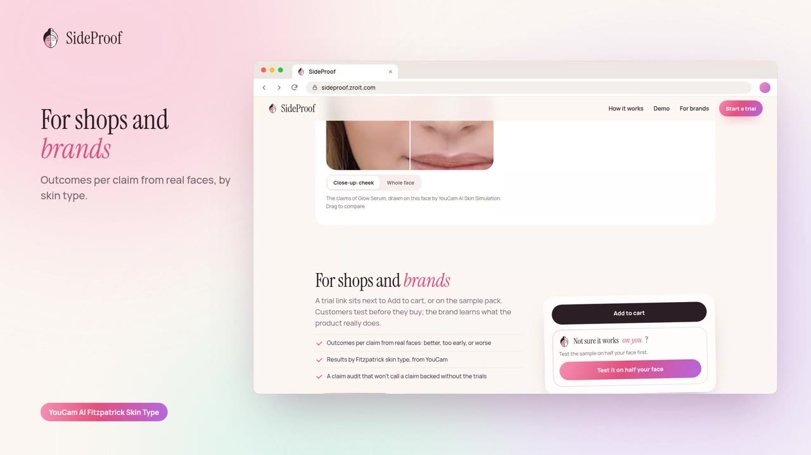

# SideProof

**Is it working? Test it on half your face.**

Skin apps compare today's selfie with last week's. But light, sleep, weather and the camera
change between photos, so a better score can't tell you whether the product did it.
Dermatology trials solve this with a split-face design: the product goes on one half of the
face and the other half is the control. SideProof brings that design to anyone with a phone,
on top of YouCam Skin AI.

The demo video (2:41): https://youtu.be/xlNaY7hIKEg

| | | |
|---|---|---|
|  |  |  |
| On the web | A trial link next to Add to bag | Camera or gallery |
|  |  |  |
| Side light refused, for free | The promise, on this face | Every scan, both halves |
|  |  |  |
| The verdict, claim by claim | Over a full day: supported | For shops and brands |

## Try it

- **App (web):** https://sideproof.zroit.com on a phone or a desktop browser. "See a finished
  trial" opens a recorded trial without spending anything; "How it works" shows the idea in
  four animated pictures.
- **Android:** a Flutter app on the same backend:
  https://sideproof.zroit.com/dl/za5rjn7j/sideproof.apk
- **The staged photo set** from the video, to run the same trial:
  https://sideproof.zroit.com/dl/za5rjn7j/sideproof-photos.zip (README inside).
- **A shop's product page with the trial on it:** `https://sideproof.zroit.com/shop/<code>`
  (the code is in the submission's testing notes). The brand, Kestrel & Fern, is made up.
- **Brand dashboard, read-only:** https://sideproof.zroit.com/dashboard with the view token
  from the testing notes.
- **API:** https://sideproof.zroit.com/docs.

## How it works

1. **Plan.** Photograph the label or paste the shop's claims. An agent maps each claim to
   what YouCam Skin AI can measure (at most 4 concerns, so a scan costs 9 units), sets how
   long the trial runs (oil and dryness move in hours, redness in days, spots and pores in
   weeks), and flags ingredients that should not go on a face without a doctor.
2. **Baseline.** Two photos before any product. They give the face's own left-right
   difference and how much a measurement moves between two photos (the noise).
3. **Trial.** The product goes on one half, picked at random. Before a photo is sent, the
   server checks one face, a straight pose, sharpness, and that **both halves get the same
   light**, since side light would fake a difference. A photo that fails costs no units.
4. **Measure.** YouCam Skin Analysis returns a mask per concern. SideProof finds the face's
   midline with MediaPipe landmarks and measures each mask on each half. The effect is
   (treated minus control now) minus (treated minus control at baseline), compared with the
   noise: *better*, *worse* or *too early to tell*.
5. **Decide.** After each scan the agent picks the next step from the steps the trial math
   allows (it cannot skip the baseline or overrule a safety stop: redness or breakouts
   rising on the treated half stop the trial). At the end it writes the verdict and checks
   each claim of the product.

The agent decides and explains; it never measures. Every number comes from YouCam or from
the trial math, and an answer that quotes a number the tools never returned is sent back.

## The app

Before the first trial, "How it works" walks through the design in four animated pictures:
weather and sleep change the whole face, the product goes on one half, YouCam maps both
halves, only a change past the noise counts. A trial then shows where it is (baseline,
product on, scans, verdict), what to do before each photo (face a window, bare skin, look
straight, same spot), which half gets the product, the agent's next step after each scan, a
chart per concern of the treated half against the control with the noise band, and the
verdict: a split disc in the result's colour and each claim with its result. The web app
(Next.js) and the Android app (Flutter) share the backend and the design.

## For shops and brands

A shop adds a product and gets a trial code, a link and an embed snippet for its product page
or the sample pack. Its dashboard shows, per concern, how many customers' trials came out
better, unclear or worse, also by Fitzpatrick skin type, and a claim audit: the agent checks
each claim in the listing against those trials and may not call a claim backed on fewer
than 3 trials.

## YouCam APIs used

- **AI Skin Analysis** (v2.1, SD): scores and the per-concern masks SideProof splits by half.
- **AI Skin Simulation**: the promise. Before the trial, what the claimed effect would look
  like on the person's own face, drawn on the treated half, so the result has something to be
  held against.
- **AI Fitzpatrick Skin Type**: once per trial, on the photo YouCam already holds.

## Privacy

Photos are measured in memory and dropped. The server keeps numbers only: per-half coverage,
scores, the agent's steps. The language model never sees a face, only the label photo and
numbers. YouCam keeps uploaded files for 30 days under its own retention policy.

## Layout

- `backend/` Python, FastAPI, SQLite. `sideproof/api.py` is the HTTP API (OpenAPI docs at
  `/docs`), `face.py` the photo checks and the per-half measurement, `trial.py` the trial
  math, `agent.py` the agent, `llm.py` the model providers, `admin.py` the dashboard.
- `web/` Next.js (static export) for the browser: the landing page, the demo trial, new trial,
  and the trial itself with YouCam's maps on the person's own photo. Its build is committed as
  `web-dist/`, which the backend serves.
- `app/` Flutter for Android. `lib/explainer.dart` is How it works, `lib/brand.dart` the mark
  and the face drawing, `tool/make_icons.py` the launcher icons.
- `backend/demo/` the two demo trials the app opens without spending units, recorded through
  the real API (YouCam Skin Analysis and Skin Simulation, the agent, the trial math) on
  YouCam's own sample faces. `demo_trial.json` (Matte Gel, by `scripts/record_demo.py`): the
  product is a digital matte filter on the treated half. `serum_trial.json` (Glow Serum, by
  `scripts/record_serum_demo.py`): the product's effect is YouCam AI Skin Simulation at rising
  strength. In both the clock moves forward between scans. Their pictures are in
  `demo/media/<trial id>/`.
- `downloads/` the Android APK, served at `/dl/`.

## Run it

Backend:

    cd backend
    python3 -m venv .venv && .venv/bin/pip install -r requirements-dev.txt
    curl -L -o models/face_landmarker.task https://storage.googleapis.com/mediapipe-models/face_landmarker/face_landmarker/float16/latest/face_landmarker.task
    export YOUCAM_API_KEY=...            # or YOUCAM_API_KEY_FILE=/path/to/file
    export SIDEPROOF_LLM=gemini GEMINI_API_KEY=...   # or deepseek / claude-cli
    export SIDEPROOF_ADMIN_TOKEN=...      # the dashboard at /admin
    export SIDEPROOF_VIEW_TOKEN=...       # the same dashboard read-only, at /dashboard
    .venv/bin/uvicorn sideproof.api:app --port 8000
    .venv/bin/pytest

Other settings: `SIDEPROOF_DB` (SQLite path), `SIDEPROOF_WEB_DIR` (serve the web build from the
same host), `SIDEPROOF_DOWNLOADS_DIR` (serve `downloads/` at `/dl/`), `SIDEPROOF_PUBLIC_URL` (for trial links), `SIDEPROOF_ADMIN_HOST` (serve
`/admin` only on that host name; `/dashboard` stays on every host), `GEMINI_MODEL` (default
`gemini-3.5-flash`, with `gemini-3.1-flash-lite` as the fallback). The agent model can also be
changed on the dashboard: `gemini` (reads label photos), `deepseek` (text only) or
`claude-cli` (Claude Code on the same host, for development). Each key can also come from a file through `NAME_FILE`; the file holds
the bare key or `NAME=value` lines.

Web:

    cd web
    npm install && npm run build && rsync -a --delete out/ ../web-dist/   # the image serves web-dist/

Android:

    cd app
    flutter test
    flutter build apk --release --dart-define=API_BASE=https://your-backend

Built solo, with Claude Code as a coding assistant.

## Licence

MIT
